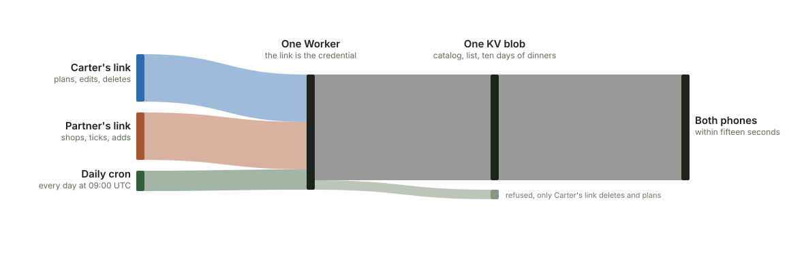
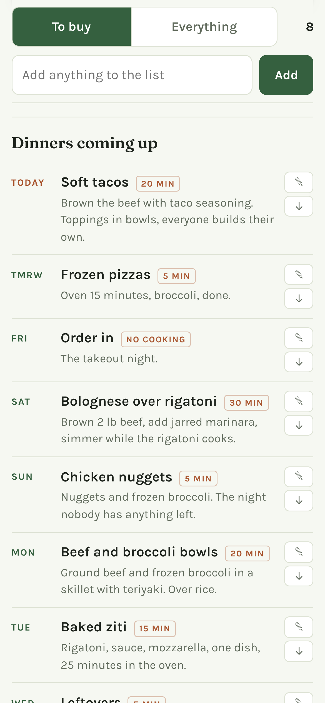
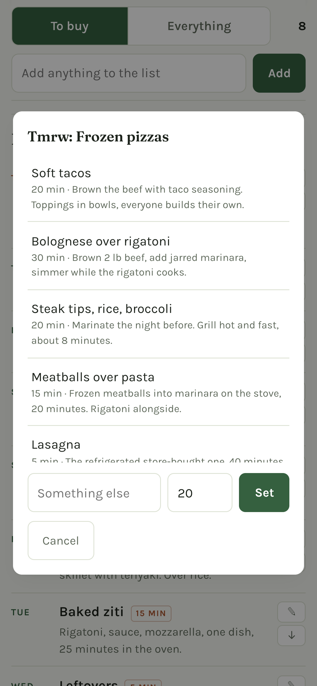
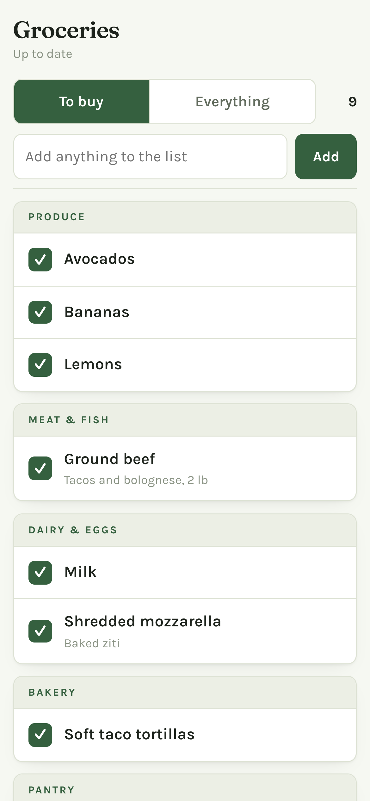

# Powers grocery list

A shared grocery list and dinner planner for a two-person household, running as a
single Cloudflare Worker. There are no accounts and no app store: each person gets a
private link, and the link itself is the credential. Carter's link plans dinners and
edits the catalog. Partner's link shops, ticks things off and adds items. When either
of them ticks something off, it is gone for the other within fifteen seconds. A cron
trigger at 5am fills any empty dinner night for the next ten days.

This is a public copy of a personal project, shared as an example of how small a
useful shared app can be: one Worker, one KV blob, one HTML page, and a test suite
that drives two simulated phones against the real request handler.

<picture>
  <source media="(prefers-color-scheme: dark)" srcset="docs/assets/how-it-works-dark.svg">
  
</picture>

## What it looks like

These are shot at phone width from a local demo with sample data, not a real household's list.

From left to right: the next ten days of dinners, the picker the planner's link uses
to change a night, and the shopping view right after adding Lemons, which the app
filed under Produce without being asked.

## How it works

One Cloudflare Worker serves the page and a two-route API, `/api/state` and
`/api/mutate`. Behind it is one KV namespace holding one JSON blob: the catalog of
everything they buy, which of those are currently wanted, and the dinner plan. There
are no tables and nothing to migrate. The whole state is small enough to send on
every poll.

The URL path is the credential. `/<token>` serves the page, and three secrets map to
three roles. Partner's token can tick items and add them. Carter's can also delete
from the catalog and edit or swap dinners. Anything else gets a 404 that does not say
why. The page is served `noindex` and `no-referrer` so the link cannot leak into a
search index or an outbound request. The link is the password, which is the right
trade for a grocery list and the wrong one for anything else. SETUP.md is blunter
about this under "Security, honestly".

Typing into the Add box files the item into one of eight aisles by a table of
patterns, falling back to Pantry when nothing matches, so nobody has to pick an aisle
from a menu while standing in one. Patterns match whole words, so "lemon" files Lemons
in Produce but leaves Lemonade for Drinks. When the guess is still wrong, either of
them can tap ⇄ on the item in Everything and pick the right aisle. The item keeps
that aisle from then on.

A cron trigger at 09:00 UTC, which is 5am Eastern and before anyone looks, fills
every empty night from today through day nine from a rotation of dinners they
actually cook. It flags its own picks, so a night somebody chose is never overwritten.
It is a floor rather than a planner: it exists so the window is never empty even if
nothing else in the system runs that day.

## Ticking something off

The To buy view is the one that matters in the store. A row carries a small name
label only when the other person is the one who put it on. Tapping a row clears it,
and it leaves this view on the other phone too, on the next poll or the moment the
other person pulls to refresh. The footer on the shopper's link says the same thing
in one line: "Everything you tick or add shows up on Carter's list too."

Items can also carry a short store tag (Store A or Store B) for the few things that
only one shop sells.

## Running it yourself

The one-time deploy is in [SETUP.md](SETUP.md): a free Cloudflare account, one KV
namespace, three secrets, and a seed. About ten minutes.

After that, `worker.js` is generated. Edit the files in `src/` and then:

    npm run build     # regenerate worker.js from src/
    npm test          # list rules, API and auth, two browsers in a real DOM, dinner window, cron
    npm run deploy    # build and test first, then push to Cloudflare

`npm run deploy` will not ship a failing test suite, so running it is the short way
to do all three.

## Screenshots of your own deployment

`npm run capture` shoots your deployed Worker at phone width into `docs/images`.
The URL carries the auth token in its path, so it comes from an ignored file:

    cp .env.capture.example .env.capture   # then fill in your URL and token
    npx playwright install chrome          # first time only
    CAPTURE_URL=$(grep -v '^#' .env.capture | cut -d= -f2-) npm run capture

The viewport heights in `docs/capture_screenshots.mjs` were measured against one
particular list. If a shot cuts a row in half on yours, re-measure rather than
nudging the number.
